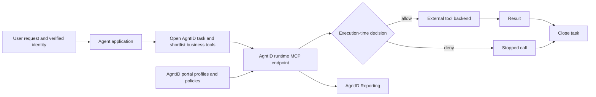
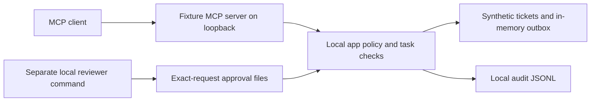

# Architecture and trust boundaries

## Real AgntID path

The portal configures profiles and policies; the customer-hosted runtime
receives signed updates, filters tool visibility, and checks calls locally.
The SDK creates task context, binds calls to it, strips runtime metadata from
model-facing results, and closes tasks. It does not grant permission itself.

The final agent should have one governed route. Keep underlying tool credentials
on the runtime/backend side and prevent raw backend access from the agent.
An intent shortlist can reduce exposure; runtime policy remains authoritative.

## Local rehearsal path

This path is implemented in `src/`. It helps rehearse tool boundaries while the
platform is being provisioned. It does not contact AgntID or an LLM and cannot
prove the platform's control behavior. The application lease is a local timer,
not an AgntID-issued credential.

## File responsibilities

| File | Responsibility |
| --- | --- |
| `src/config.ts` | Validated trusted startup context and bounded lease |
| `src/runtime.ts` | Fixture ownership/task checks, policy lookup, one-time approval consumption, audit |
| `src/tools.ts` | MCP names, strict input/output schemas, annotations, sanitized failures |
| `src/http.ts` | Loopback HTTP transport with Host/Origin checks |
| `src/server.ts` | HTTP/stdio startup and shutdown |
| `src/approve.ts` | Separate reviewer interface; absent from MCP tool list |
| `src/probe.ts` | Actual MCP connectivity checks |
| `examples/agntid_smoke.py` | Official SDK lifecycle and protected built-in demo call |

## Permission matrix for a candidate support workflow

This is a design worksheet; only the local fixture implementation is present.

| Action | Local scope | Local approval | Real project work |
| --- | --- | --- | --- |
| Read ticket | Trusted tenant and task ticket list | No | Add backend user ownership and AgntID input/resource policy |
| Draft reply | Same scope; 1–2000 characters | No | Keep generated draft unsent and visible to user |
| Send reply | Same scope, current lease, exact approved text | One use | Use documented platform approval or a trusted backend reviewer |
| Read another tenant | Denied | Cannot override | Prove denial through AgntID and confirm backend unchanged |
| Add refunds/deletes/admin tools | Absent and denied | Not implemented | Add only if needed, with explicitly reviewed controls |

## Limits

The fixture server is a single-user, single-task local service. Same-OS-user
shell access can change its environment, policy, and reviewer files. It is not
a sandbox against a host-capable agent. The local audit is not tamper-evident;
the synthetic outbox is not durable. Production tenant identity must come from
verified application state, not these demo defaults.

Approval replay is guarded by atomic file movement, and an approval is bound
to the lease, task, agent, tenant, ticket, tool, text, and expiry. These controls
are tested, but they are still local example logic. The final evidence should
separate backend controls from AgntID's own decision and audit records.
